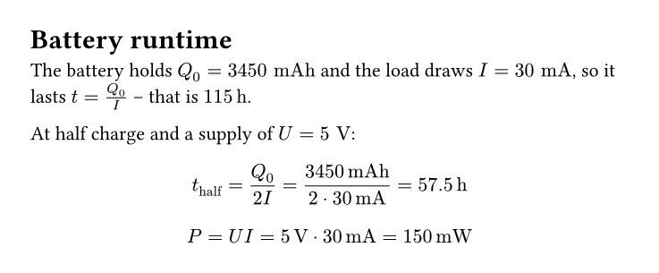
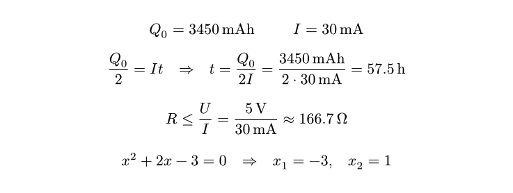
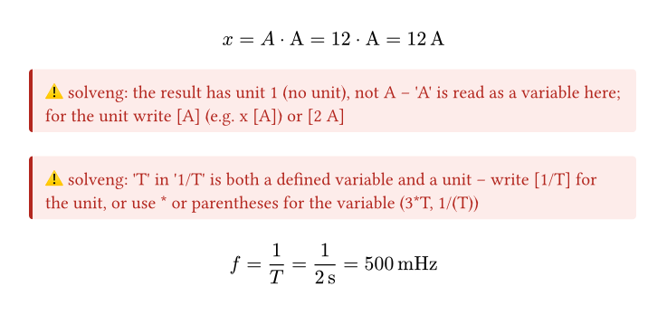
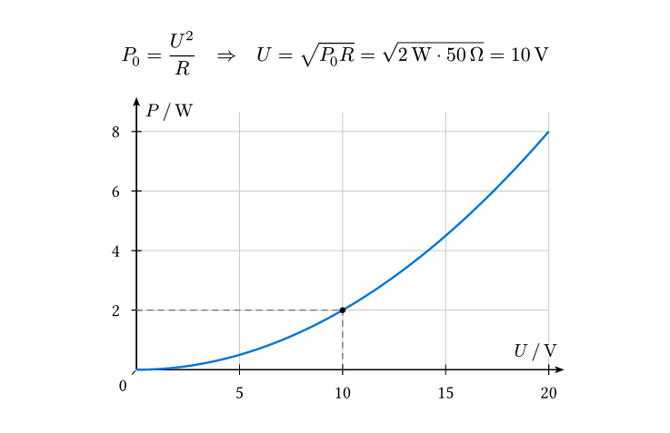

# solveng

Unit-aware engineering calculations that read like your notes. **Write the math as you normally would – solveng evaluates it.** No `#def` for every value, no special syntax: equations in the text define values, code blocks are calculated line by line, and every result comes with the rearranged formula, the substituted numbers and a sensible unit.

````typ
#import "@preview/solveng:0.1.0": *
#show: solve-block

= Battery runtime
The battery holds $Q_0 = 3450 "mAh"$ and the load draws $I = 30 "mA"$,
so it lasts $t = Q_0 / I$ – that is `= t -> h`.

At half charge and a supply of $U = 5 "V"$:
```
t_half = Q_0 / (2 I) -> h
P = U I
```
````



That is the whole document – no function calls for the calculation:

- **Math defines values.** Every `$… = …$` in the text is read: `$I = 30 "mA"$` is a value, `$t = Q_0 / I$` is computed, `$Q_0/2 = I t$` is solved for the unknown. The equation stays exactly as you wrote it.
- **Code blocks calculate themselves.** Each line of a plain ```` ``` ```` block is solved and shown with all steps; `-> h` picks the unit, `;` separates a system, `//` is a comment.
- **Inline code shows a result** in the running text: `` `t = Q_0/I -> h` `` gives *t = 115 h*, `` `= t -> h` `` just *115 h*.

`#show: solve-block` turns this on for the whole document; `#solve-block[…]` for a part (its definitions are dropped afterwards). See [Math and code in solve-block](#math-and-code-in-solve-block).

### When you want more control: `def` and `solve`

The same calculations as function calls – for options per result, or outside a solve-block:

```typ
#def("Q0 = 3450 mAh", "I = 30 mA")      // silent definitions
#definitions()                           // Q₀ = 3450 mAh   I = 30 mA
#solve("Q0/2 = I t", unit: "h")          // Q₀/2 = I t ⇒ t = Q₀/(2I) = 3450 mAh/(2·30 mA) = 57,5 h
#solve("R <= U/I")                       // inequalities, polynomials (all roots), systems
```



Both mix freely: inside a solve-block, `#solve(…)` and `#val("t", unit: "h")` see the values defined by the math around them.

## Math and code in solve-block

Inside `#solve-block[…]` (or after `#show: solve-block` for the whole document), every math equation with a `=` is a definition, exactly like `#def`: `$I = "30 mA"$`, `$P = U I$`, `$Q_0/2 = I t$`. The equation stays as you wrote it; problems are shown next to it. An inequality with exactly one unknown (`$R <= U/I$`) defines it like `#solve("R <= U/I")`; `$0 < x < 1$` and inequalities between known values stay prose. Equations without `=` (`$x^2$`), derivations with `⇒`, `≈`, … (`$ Q = I t => t = Q/I $`), equations with alignment or line breaks (`$ U &= R I \ &= 6 V $`) or with embedded calls like `#val` are left alone. In a worked chain `$R = 7.2 "k"Omega = 7200 Omega$` the first `=` defines, the rest are steps. A step that writes an undefined variable out defines it: `$R = rho dot frac(l, A) = rho dot frac(l, b dot h)$` defines `A = b h`; with `R` given instead, `b` is solved from the most written-out step (`R = ρ l/(b h)`) and `A` follows. Math is written as usual: a number followed by units is a value (`frac(3450 "mAh", 30 "mA")`, `9.81 "m"/"s"^2`), `0,95` is a decimal number. Quoted units (`"h"`) are always units; a bare letter that is a defined variable is that variable (`$3 h$` with a variable `h` is 3 times h), see [Units and variables](#units-and-variables). `#solve-block(equations: false)[…]` turns this off.

Code without a language (or with `solve`) is evaluated too:

- A code block: every line is a definition that shows itself, exactly like `#solve(line)`.
- Inline code `` `t = Q0/I -> h` `` defines and shows inline with `inline-steps` (default `"result"`: t = 115 h).
- `` `= Q0/I -> h` ``: just the value (115 h), nothing is defined.

Per line: `-> unit` for the result unit, `;` separates the equations of a system (`x + y = 3; x - y = 1`), `//` starts a comment. Code with another language (```` ```py ````) is left alone.

The output of `def`, `solve`, `val`, `definitions` and `graph` is never read as a definition again.

`solve-block` decides *where* calculations happen and takes only `inherit`, `equations` and `reset`; *how* results look is set with `solve-config`:

```typ
#show: solve-config.with(digits: 3, layout: "column")
#show: solve-block.with(reset: heading)
```

To start over at every heading (each exercise on its own), pass `reset`:

```typ
#show: solve-block.with(reset: heading)                    // every heading
#show: solve-block.with(reset: heading.where(level: 1))    // only top-level ones
#show: solve-block.with(reset: heading, inherit: true)     // keep the definitions made before the block
```

`#reset` inside a solve-block does the same: back to how the block started (with `inherit: true` the outer definitions stay); after the block the outer ones come back.

## Functions

| call | does |
|---|---|
| `#def("R = 7.2 kOhm")`, `#def("R = 7.2 kOhm", $I = 30 "mA"$)` | define values (silent) |
| `#def("U = R I")` | define from other values (computed, silent) |
| `#def("f(x) = x^2 + 1")`, `#def("g(a, b) = a b + b")` | define a function, usable in later equations: `f(3)`, `g(2, R)` |
| `#def("Q0/2 = I t")` | an equation: its unknown is solved for and defined |
| `#def(…, output: true)` | show what was defined (as `solve` does) |
| `#solve(…)` | `def` that shows itself: equation ⇒ formula = numbers = result |
| `#solve(eq, unit: "mA")` | result in a given unit (default: SI unit with automatic prefix, or the non-SI unit of the inputs like h, mAh); an error if the result has another unit |
| `#solve("I", unit: "A")` | no `=`: just evaluate / convert → `I = 30 mA = 0,03 A`; a computed variable shows its formula with the values: `#solve("b")` → `b = ρ l/(R h) = … ≈ 1 mm` |
| `#solve("f(1) = x")` | the unknowns are found on either side; if everything is known, a lone variable is recomputed |
| `#solve("x^2 + 2x - 3 = 0")` | the unknown occurs several times → all real roots |
| `#solve("P = U I", "U = R I")` | a system: as many equations as unknowns |
| `#solve("R <= U/I")`, `#solve($R <= U/I$)` | an inequality (`<`, `>`, `<=`, `>=`, `≤`, `≥`): `R ≤ U/I = … ≈ 166,7 Ω`, flipped where needed (`U/R > I` ⇒ `R < U/I`). The bound is stored as R's value, `#solve("R")` shows `R ≤ 166,7 Ω`. Only one boundary (`y^2 < 4` is refused), not in systems |
| `#solve($U = R dot I$)` | equations and values can be math too |
| `#solve-block[ … ]` | scope: definitions inside are dropped afterwards (`inherit: true` sees outer ones); math and code inside are evaluated, see below |
| `#definitions()` | everything defined so far, in columns side by side, see below |
| `#val("U")`, `#val("I", unit: "A")` | a value inline, optionally converted |
| `#reset` | forget everything (in a solve-block: the block's definitions) |
| `#solve-config(…)` | options for how results look and which units exist, see [Configuration](#configuration) |
| `#graph("P = U^2/R", x: "U")` | a plot, see [Plots](#plots) |
| `#context lambdify("U^2/R", "U")` | the expression as a plain Typst function, see [lambdify](#lambdify) |

Every positional argument of `def` / `solve` is an equation, as a string or math. Everything else is a named argument; each one is checked, so a typo or a value of the wrong type is reported instead of being ignored. (Typst has no type annotations, so the types are checked when the document compiles.)

| argument | default | |
|---|---|---|
| `unit` | `none` | `"mA"` (also math: `$"mA"$`) for the unknown, `(I: "mA", U: "V")` for systems |
| `output` | `false` (`def`), `true` (`solve`) | show the definition |
| `steps` | `auto` (option `steps`) | `"full"`: equation ⇒ formula = numbers = result · `"formula"`: without the numbers · `"result"`: `t = 57,5 h` · `"value"`: just `57,5 h` |
| `layout` | `auto` (option `layout`) | `"row"`: all steps in one line · `"column"`: one step per line, aligned at `=` |
| `inline` | `false` | in the running text instead of a display block; steps default to the option `inline-steps` (`"result"`) |
| `unknown` | `none` | what to solve for (`"t"` or `("x", "y")`), needed when it isn't clear |
| `root` | `auto` | which solution is stored: `2`, or `x => x > 0` (default: the only all-positive one, else the first) |
| `guess` | `none` | Newton start value instead of searching: `"-1 A"`, `(U: "5 V")` |
| `listed` | `true` | `false` hides it from `definitions` |
| `digits`, `form`, … | `auto` | any [option](#configuration) for this call; `auto` keeps the current setting |
| `config` | `(:)` | the same options as a dictionary: `config: (digits: 2)` |

```typ
Runtime: #solve("Q0/I", unit: "h", inline: true, steps: "value")      // Runtime: 115 h
#solve("Q0/2 = I t", unit: "h", layout: "column", steps: "formula")
```

### Defaults for solve

Typst only allows `#set` for its built-in elements, not for functions of packages, so `#set solve(steps: "result")` isn't possible (yet). Instead:

```typ
#let solve = solve.with(steps: "result", layout: "column")   // your solve calls from here on
#show: solve-config.with(steps: "result")                    // everything, including code in solve-block
```

## Definitions

```typ
#definitions()                                          // everything
#definitions(included: "given")                         // only plain values (also "computed", "function")
#definitions(excluded: ("U", "function"))               // names and kinds
#definitions(included: regex("^R"), style: "column")    // a regex, or a function name => bool
#definitions(si: true, config: (digits: 3))             // style and si directly, other options as config
```

Styles (`style:` here, option `definitions` for all of them):

- `"grid"` (default): as many columns side by side as fit, filled top to bottom, each aligned at `=`. In HTML the columns reflow with the window width.
- `"column"`: one column aligned at `=` (in HTML a table).
- `"inline"`: comma separated in the text.
- `"list"`: bullets.

`include` is a Typst keyword, hence `included` / `excluded`. Both take `"all"`, a kind, a name, a regex, a function or an array of these; `excluded` wins.

## Errors

Problems (an unknown unit, a missing value, units that don't match, a typo) are shown as a red note where they happen; the rest of the document still compiles:

> ⚠ solveng: 1 equation but 2 unknowns (Q0, t) in 'Q0/2 = I t' – define the missing values first, or pass unknown: …

`#show: solve-config.with(errors: "panic")` stops the compilation instead (useful in CI).

## Units and variables

Many engineering symbols are also units: `A` (area, ampere), `V` (volume, volt), `T` (period, tesla), `h` (height, hour), `C`, `F`, `W`, `m`, `s`, `l`, `L`, … solveng keeps them apart by *how* they are written, never by guessing:

- **Strings:** a unit is read only where a value is written – right after a number (`"I = 30 mA"`) or in brackets (`[5 V]`, `[A]` for one ampere). Every other name in an equation is a variable.
- **Math:** quoted text is a unit (`$30 "mA"$`, `$3 "h"$` – set upright, as units should be); a bare letter is a variable if one with that name is defined (`$3 h$` with `h` defined is 3 times h, in italics), else a unit after a number (`$5 V$`).
- **Unclear is an error:** a value whose unit is also a defined variable (`"t = 3 h"` with `h` defined, `"f = 1/T"` with `T` defined) is refused, with a hint how to write either meaning: `[3 h]` for hours, `3*h` or `1/(T)` for the variable.

```typ
#def("A = 12")
#solve("x = A [A]")                  // x = A · A = 12 · A = 12 A
#solve("y = A A", unit: "A")         // error: the result has unit 1, not A – 'A' is read as a variable here; …
#def("T = 2 s")
#def("f = 1/T")                      // error: 'T' in '1/T' is both a defined variable and a unit – …
#solve("f = 1/(T)")                  // f = 1/T = 1/(2 s) = 500 mHz
```



For documents where nothing may be read two ways, `#solve-config(strict: true)` also refuses unit names as variable names (`A = 3 m^2` → pick `A_1`, or remove the unit) and bare units in math (`$5 V$` → `$5 "V"$`).

The available units can be changed with the option `units`: new units are defined by a value, `none` removes one (which frees its name, e.g. `T` for a period that is then never read as tesla):

```typ
#solve-config(units: (bar: "100 kPa", rpm: "1/min", t: "1000 kg", T: none))
#def("p = 3 bar", "n = 3000 rpm")    // prefixes work too: mbar, kbar
#solve-config(prefer: ("bar", "kWh")) // results with these dimensions are shown in these units
```

## Writing values

```typ
#def("R = 4.7 kOhm")                // strings: name = number + unit ("I = 30mA" works without the space too)
#def($R = 4.7 "k"Omega$)            // math content
#def($I = frac(2, 4) "A"$, "Q0 = 3450/2 mAh", "U = (1+2)*1,5 V", "A = 2^3 m^2")  // arithmetic in the number
#def("R2 = 2 R", "Z = [5 V] / I")   // [5 V] is a value inside an equation, @R inlines R's formula
```

- **Units:** SI base units (m kg s A K mol cd) and V A Ω W J C F H S Hz N Pa T Wb, min h Ah Wh As Ws eV l %, ‰, °, rad, °C (as a temperature *difference*), all SI prefixes; your own with the option `units`. Powers as `m^2`, `m²`, `s^-1`; quotients as `m/s^2`; products with spaces `kg m`.
- **Typeable spellings:** `Ohm`/`ohm`/`Omega` → Ω, `u` → µ, `degC` → °C, `deg` → °. They are printed with the proper symbols (`"20 uA"` → 20 µA).
- **Decimal comma:** `"7,2 V"` works; the output separator follows the document language.
- **Names:** `Q0`→Q₀, `R_min`→R_min, `rho`→ρ, `DeltaT`→ΔT, `tol`→tol (upright). In math equations `Q_0` is a different variable than `Q0`.
- **Operators:** `+ - * / ^ · ×`, implicit multiplication (`2 pi f C`), `sqrt exp ln log sin cos tan asin acos atan abs`, constants `pi e` (unless you define a variable with that name), your own functions.

## Configuration

Every option can be set for the rest of the document, for a part, or for one call:

```typ
#show: solve-config.with(digits: 3, form: "fraction")   // your defaults: at the top of the document
#solve-config(layout: "column")                          // from here on, definitions are kept
#solve-config(steps: "result")[ … ]                      // only inside the brackets
#solve("U = R I", digits: 2)                             // only this call (val, definitions, graph: config: (digits: 2))
```

To reuse your defaults in many documents, keep a small file of your own:

```typ
// my-defaults.typ
#import "@preview/solveng:0.1.0": *
#let setup = solve-config.with(digits: 3, times: "times", layout: "column")
#let solve = solve.with(steps: "formula")

// in a document
#import "my-defaults.typ": *
#show: setup
```

### Numbers

| option | default | values | effect |
|---|---|---|---|
| `digits` | `4` | 1…15 | significant digits of computed values (`57,5 h`, `123500` instead of `123456`) |
| `zeros` | `false` | bool | keep trailing zeros up to `digits` (`2,500 V`) |
| `sep` | `"lang"` | `"lang"`, `","`, `"."`, any string | decimal separator; `"lang"` is `,` for de, fr, it, es, pt, nl, ru, pl, cs, … and `.` otherwise |
| `group` | `none` | `none`, `" "`, `sym.space.thin`, `"'"`, … | digit grouping for integer parts with 5+ digits (`12 345,678`) |
| `sci` | `(-3, 6)` | `(low, high)` or `none` | plain notation while the exponent is in `low ≤ e < high`, else `2,5 · 10⁻⁷`; `none` never switches |
| `eng` | `false` | bool | engineering notation: exponents in steps of 3 |
| `times` | `"dot"` | `"dot"`, `"times"` | `2 · 10⁶` or `2 × 10⁶` |
| `form` | `"auto"` | see below | how values are written |
| `frac-max` | `1000` | int | largest denominator for `form: "fraction"` |
| `slash` | `false` | bool | fractions as `1/2` instead of stacked |

`form`:

- `"auto"`: plain numbers as typed (`7.20 kΩ` keeps its zero), arithmetic evaluated (`3450/2 mAh` → 1725 mAh), results rounded to `digits`.
- `"decimal"`: everything rounded to `digits`, including what you typed.
- `"fraction"`: exact fractions, simplified (`$frac(2, 4)"A"$` → ½ A, `I/3` → ⅙ A); values that are no fraction with denominator ≤ `frac-max` fall back to decimals.
- `"input"`: given values exactly as typed (`3450/2 mAh` stays a fraction).

### Units

| option | default | values | effect |
|---|---|---|---|
| `prefixes` | `"all"` | `"all"`, `none`, array like `("m", "k")` | prefixes picked for results: `"all"` uses a f p n µ m k M G T (times from a minute on in min or h instead of ks), `none` keeps the base unit (`0,0005 A` or `5 · 10⁻⁴ A`), an array allows only those (`"u"` = µ; `"c"`, `"d"` are allowed too) |
| `si` | `false` | bool | `definitions` also shows the SI value: `Q₀ = 3450 mAh = 12420 C` |
| `units` | `(:)` | dictionary | your own units, `(bar: "100 kPa", rpm: "1/min")`, defined by a value in known units; `none` removes a unit, `(T: none)`. Adds to the units set before. Only in `solve-config`, not per call |
| `prefer` | `()` | array of units | units for results of their dimension, `("bar", "kWh")`, before the unit of the inputs and the SI unit |
| `strict` | `false` | bool | unit names can't be variable names, and units in math must be quoted (`$5 "V"$`), see [Units and variables](#units-and-variables) |

An explicit unit (`#solve(eq, unit: "mA")`, `#val("I", unit: "A")`) always wins, then `prefer`, then the non-SI unit of the inputs (h, mAh, bar), then the SI unit with a prefix.

In `solve-config`, `def` and `solve` every option defaults to `auto`, which keeps the current setting.

### Output

| option | default | values | effect |
|---|---|---|---|
| `steps` | `"full"` | `"full"`, `"formula"`, `"result"`, `"value"` | default for `steps:` (see above) |
| `inline-steps` | `"result"` | same | steps for `inline: true` and inline code |
| `layout` | `"row"` | `"row"`, `"column"` | default for `layout:` |
| `implies` | `sym.arrow.r.double` | any content | the ⇒ between steps (e.g. `sym.arrow.r.long`, `[and]`) |
| `approx` | `true` | bool | `≈` when the shown result is rounded; `false` always writes `=` |
| `block` | `true` | bool | display equations (centred) or inline |
| `solutions` | `6` | int | how many solutions are listed (all are found; `root:` picks among all) |
| `definitions` | `"grid"` | `"grid"`, `"column"`, `"inline"`, `"list"` | how `definitions` looks: columns side by side, one aligned column (in HTML: a table), comma separated in the text, or bullets |
| `errors` | `"document"` | `"document"`, `"panic"` | show problems in the document, or stop |

Options passed to `#def(…)` (directly or as `config: …`) stick to those values, so `definitions` shows them the same way.

## HTML

With `typst compile --features html --format html`, equations become MathML, `definitions` columns that reflow with the width (or a table with `style: "column"`), graphs inline SVGs (via `html.frame`) that shrink with the page, errors styled notes. One small stylesheet is added to the page (math font STIX Two Math / Cambria Math / Latin Modern Math, spacing, table stripes; classes `solveng`, `solveng-defs`, `solveng-list`, `solveng-plot`, `solveng-error`).

## How it solves

If the unknown occurs once it is isolated symbolically (with substitution shown). Equations linear in it are solved symbolically too. Polynomials → all real roots (any degree). Anything else → numeric search over ±10⁻¹⁵…10¹⁵ (times the target unit): sign changes are bisected and Newton starts from every local minimum of |f|. Systems: equations with a single unknown are solved symbolically first, the rest by damped Newton from 33 starts. Units of unknowns are inferred from the equations; mismatched units stop with an error.

## Limits

Found by `tests/fuzz.py` (random equations, quantities, options and hostile inputs checked against Python):

- **Numbers** are 64-bit floats: about 15 significant digits, magnitudes up to 10³⁰⁰. Results that underflow show as 0 (`ln(x) = -800`).
- **Isolating** `x^2 = 4` or `sqrt` gives only the positive root, periodic functions only the principal value (`tan(x) = 1` → `atan(1)`). Pass `root:` or `guess:` to use the numeric search, which finds the others.
- **Numeric search** can miss roots squeezed between nearby poles, roots of very fast oscillations, and roots outside ±10¹⁵ (scaled by the target unit). In random nonlinear equations this hit about 0.1 %; the result then says "no real solution".
- **Systems** are solved numerically from a fixed set of starts; solutions far away from them can be missed. Underdetermined systems (`x + y = 2`, `2x + 2y = 4`) show one arbitrary solution.
- **Nesting:** up to about 20 levels of brackets (Typst's function call depth); sums and products of any length are fine.
- **Domains:** only real numbers; `(-8)^(1/3)` and `sqrt(-1)` are errors, as is an unknown that cancels out (`x - x`).
- **°C** is a temperature difference (no 273.15 offset); temperatures in formulas like `p V = n R T` need K. New base dimensions (bit, €) can't be added.
- **Prefixes:** a lone `m` before a unit is metre: `"m s"`, `$"m" Omega$` are m·s and Ω·m; write `"ms"`, `$"m"Omega$` for milli. See [Units and variables](#units-and-variables) for names that are both.
- **Functions** are expanded where they are used (no recursion); `f(x) = 9` with an existing `f` is an equation, not a new definition.
- **Math in solve-block:** every equation with `=` is evaluated, also ones meant as plain text (`$a^2 + b^2 = c^2$` with unknown a, b, c is an error). Put those outside the block or use `equations: false`.
- **Types** are checked at compile time: unknown named arguments of `val`, `definitions` and `graph` stop the compilation (Typst's own error), those of `def`, `solve`, `solve-config` and `solve-block` are shown in the document.
- **`#set solve(…)`** is not possible in Typst; use `solve.with(…)` or `solve-config` (see above).
- **HTML** export is experimental in Typst; in column layout browsers drop the space after a leading `=`.

## Plots

Uses `@preview/simple-plot:1.1.0`.



```typ
#def("R = 50 Ω", "P0 = 2 W")
#solve("P0 = U^2/R")
#graph("P = U^2/R", x: "U")                                // range 0…2·U, solved point marked with guide lines
#graph("P = U^2/R", x: "R", xrange: ("10 Ω", "1 kΩ"))     // the x range
#graph("cos(w) = w")                                       // both sides as curves, intersection marked, range picked
#graph("y = x^2", "y = 2x + 3", colors: (gray, blue))      // several curves in one graph
#def("v0 = 2 m/s", "a = 1 m/s^2")
#graph("s = v0 t + a/2 t^2", xrange: ("-6 s", "3 s"))
#graph("P = U^2/R", x: "R", xrange: (0, "2 R"), mark: ("R", "extrema"))
#graph("P = U^2/R", x: "R", ymark: "P0")                   // where P reaches P0
```

`graph` picks ranges, nice ticks (with the document's decimal separator), axis labels `U / V` and units automatically.
Every positional string or math is a curve; curves of the same unit share one graph, with a legend.

Ranges: `xrange:` / `yrange:` list values that must be visible: numbers (in `xunit` / `yunit`, else the SI unit), values like `"10 Ω"` or expressions of defined variables like `"2 R"` (math works too). Values and expressions must have the axis unit (`$f(20) Omega$` and `"f(20) Ω"` are fine) – `xrange: ("10 Ω", "f(20)")` with a unitless `f(20)` is an error, since it isn't clear what was meant. Two or more give the range from the smallest to the largest; a single one widens the picked range. Without them: if x is defined, 0…2·x with the solved point marked; else around the marks; else around what's interesting – roots, extrema, poles, edges of the domain (√, ln) and, above all, where curves cross – rounded to nice ticks, starting at 0 when everything interesting is positive. With `ymark`, the y range is around the marked values (steep curves leave the picture). If x has no unit yet, it follows from the curve and the units of the y values (`P = U0^2/R2` with `ymark: "2 W"`: R₂ in Ω).

Marks are always visible – the ranges grow to show them:
- `mark:` x values like in `xrange` (a point with guide lines on every curve), `"crossings"`, `"roots"`, `"extrema"` (searched within the range), or `auto` (default: the solved point, or where both sides of an equation cross). Both coordinates of the points are written on the axes.
- `xmark:` the same, but only the x value is written on the axis.
- `ymark:` y values: every point where a curve reaches one; the value is written on the y axis.

Combine them in an array, `(auto, "R1")`; `mark: ()` marks nothing.
Options: `x:`, `xunit:`/`yunit:`, `samples:`, `width:`/`height:` (a number: the plot area in cm, default 8 × 5; a length like `12cm`/`300pt` or a share like `100%`: the whole graph, labels included – a share of the height is of the container, or of the width when the page grows with its content), `colors:` (a color or an array with parentheses: `(gray, blue, rgb("#f98eff"))`), `config: (…)`.
Any other named argument goes straight to simple-plot's `plot` (e.g. `show-grid: false`), other positional ones (series from simple-plot) are added as they are.

For full control, plot with simple-plot directly: any other named argument of `graph` goes to its `plot`, other positional ones are added as series.

## lambdify

`lambdify` turns an expression into a plain Typst function of numbers – for value tables, other plotting packages or your own code. It uses the current values of defined variables, so it needs `context`:

```typ
#def("R = 50 Ω")
#context {
  let P = lambdify("U^2/R", "U", unit: "W", units: (U: "V"))
  table(columns: 2, ..range(1, 6).map(u => ([#u V], [#P(u) W])).flatten())
}
```

- parameters: the names after the expression, in order (`"U", "R"`; a defined variable is replaced by the argument). Without any: the undefined variables, in the order they appear.
- arguments: numbers in the unit from `units` (else SI), or values like `"5 V"`.
- result: a float in `unit` (else SI), or `none` where the expression isn't defined (`sqrt(-1)`, `1/0`).
- Problems stop the compilation here, since the result is a function, not content.

## Testing

The tests use [tytanic](https://github.com/typst-community/tytanic) (`cargo install tytanic`):

```sh
tt run                                        # units, solving, lambdify and the README examples (reference images)
tt update readme                              # accept changed output of the README examples
```

The fuzzer checks random inputs against Python:

```sh
python3 tests/fuzz.py                         # every category, 300 cases each
python3 tests/fuzz.py -n 2000 -c solve1 --seed 7 --save /tmp/fails
```

Categories: `parse` (quantities and math content), `solve1` (random nonlinear equations), `poly`, `system`, `units` (physics formulas with random prefixes), `edge` (hostile inputs must be refused or solved right), `edge-doc` (the same inputs must never stop the compilation), `format`, `ratio`, `display` (random options must never crash). It needs `typst` on the `PATH` and reports wrong results and crashes with the document that caused them.
